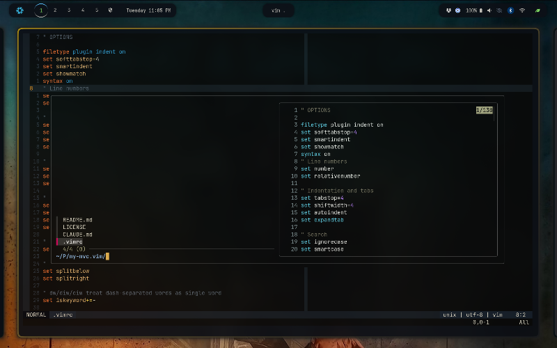

# my-mvc.vim

My "minimally viable configs" for Vim, Bash and Tmux. Each is a single file, easy to install on a server with one command. Lightweight and fast.



## Vim

### Install

```shell
curl -L https://snork.sh/mvcvim > ~/.vimrc
```

### Features

- Fuzzy file/buffer/grep search via fzf (`<Space>ff`, `<Space>fg`, `<Space>fs`, etc.)
- Ayu darker colorscheme
- Lightline statusline with git branch
- No plugin manager required — plugins self-install on first launch via `git clone`

### Keybinds

Leader key is `<Space>`. `jj` exits insert mode.

| Binding | Action |
|---|---|
| `<leader>ff` | Fuzzy find files |
| `<leader>fo` | Recent files |
| `<leader>fb` | Buffers |
| `<leader>fs` | Grep word under cursor |
| `<leader>fg` | Grep prompt |
| `<leader>fc` | Grep current filename |
| `<leader>fi` | Find files in `~/.vim` |
| `<leader>fh` | Help tags |

## Bash

### Install

```shell
curl -L https://snork.sh/mvcbash > ~/.bashrc
```

### Features

- Self-bootstrapping — missing tools install on first launch:
  - `lsd`, `tmux`, `ripgrep`, `fzf` and `bash-completion` via the system package manager (pacman, apt, dnf, zypper or brew; needs `sudo`)
  - [Starship](https://starship.rs) prompt via its official install script into `~/.local/bin` (no `sudo`)
- fzf keybindings, using `rg` to list files (hidden files included, `.git` skipped)
- bash-completion with case-insensitive tab completion
- Large, deduplicated history shared across open terminals
- `autocd`, `globstar` (`**`) and `cdspell` enabled
- `EDITOR`/`VISUAL` set to vim
- Machine-specific overrides loaded from `~/.bashrc.local` if present

### Keybinds

| Binding | Action |
|---|---|
| `Ctrl-T` | Fuzzy find files, insert path |
| `Ctrl-R` | Fuzzy search history |
| `Alt-C` | Fuzzy `cd` into a directory |

### Aliases

| Alias | Command |
|---|---|
| `ls` / `ll` / `la` | `lsd` / `lsd -l` / `lsd -la` (falls back to `ls`) |
| `lt` | `lsd --tree --depth 2` |
| `..` / `...` / `....` | Up 1 / 2 / 3 directories |
| `cp` / `mv` / `rm` | Prompt before overwrite/delete (`-i` / `-i` / `-I`) |
| `mkdir` | `mkdir -p` |
| `rgi` | `rg -i` |
| `g` | `git` |
| `gs` | `git status -sb` |
| `ga` / `gc` / `gd` / `gp` | `git add` / `commit` / `diff` / `push` |
| `gl` | `git log --oneline --graph --decorate -20` |
| `v` | `vim` |
| `reload` | Re-source `~/.bashrc` |
| `path` | Print `$PATH` one entry per line |

### Functions

| Function | Action |
|---|---|
| `fv` | Fuzzy pick a file (with preview) and open it in vim |
| `fcd` | Fuzzy pick a directory and `cd` into it |

## Tmux

### Install

```shell
curl -L https://snork.sh/mvctmux > ~/.tmux.conf
```

### Features

- Prefix is `Ctrl-Space`
- Windows and panes numbered from 1, renumbered on close
- Mouse on, 50k-line scrollback, true color (`tmux-256color` + RGB)
- OSC 52 clipboard, so copies reach your local clipboard even over SSH
- New windows and splits open in the current pane's directory
- Vi copy mode
- Theme uses your terminal's palette colors; status bar shows a prefix indicator, window number, directory, session and host
- No plugins and no external scripts

### Keybinds

All bindings follow the prefix (`Ctrl-Space`).

| Binding | Action |
|---|---|
| `\|` | Split vertically |
| `-` | Split horizontally |
| `h` / `j` / `k` / `l` | Move to left / down / up / right pane |
| `←` / `↓` / `↑` / `→` | Resize pane by 5 (repeatable) |
| `c` | New window in current directory |
| `s` | Fuzzy switch session (needs fzf) |
| `d` | Fuzzy kill sessions, multi-select (needs fzf) |
| `r` | Reload config |

In copy mode (`prefix [`): `v` starts a selection, `Ctrl-v` toggles rectangle selection and `y` copies.
